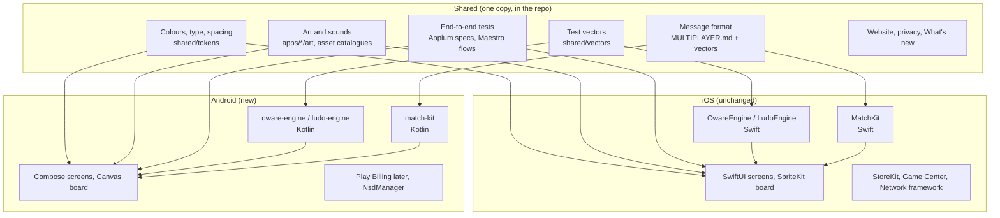
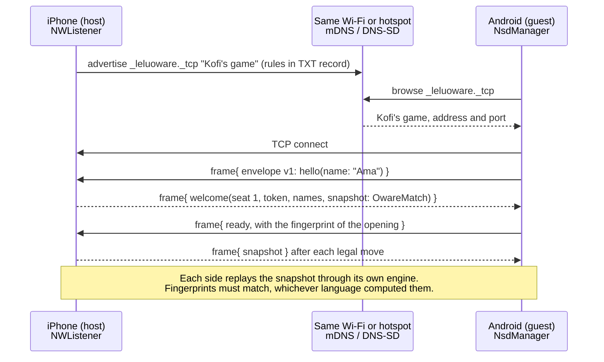

# Android: plan and designs

How Lelu Oware and Lelu Ludo get to Android phones, for the owner's review. Documents only: no
Android code exists yet. Per-app notes: [Lelu Oware](../apps/lelu-oware/docs/ANDROID.md) and
[Lelu Ludo](../apps/lelu-ludo/docs/ANDROID.md). Planned 2026-11-15.

Owner decisions this plan starts from (not reopened here):

| Decision | Choice |
|---|---|
| Kind of app | A native iOS app and a native Android app. No cross-platform UI framework. |
| Sharing | As much as possible shared anyway |
| Cost | Cheap to build and to keep going; one developer |

## 1. Summary

- **Recommendation:** write the Android apps in Kotlin with Jetpack Compose, and **port the rules
  engines to Kotlin**. Keep the two engines honest with **one set of JSON test vectors** that both
  the Swift engine and the Kotlin engine must pass. The Swift apps do not change.
- **Why:** the engines are small (about 2,700 lines of Swift for both games and their computer
  players) and the rules are settled. A port is a few days of work. Every way of sharing the
  engine *code* either puts the shipped iOS app at risk (Kotlin Multiplatform) or adds young
  tooling and a bridge that one person then has to keep working (Swift on Android, Rust).
- **What is really shared:** the test vectors, the art and sounds, the colours and sizes, the
  nearby and online message format, the end-to-end tests, CI, the website and the privacy policy.
  The screens are written twice whatever we choose: that is what "native on both" means, and it is
  about three quarters of the code.
- **Nothing in the iOS apps is impossible on Android.** Five things do not carry across or behave
  differently (§3.1): Game Center, phone-to-phone play with no Wi-Fi network, the "founding player"
  check, Apple's serif typeface and symbols, and the Silent switch.
- **Cost:** US$25 once for Google Play. A new personal account must run a closed test with 12
  testers for 14 days before the app can be public. Friends can play before that through the
  internal testing track (§6).
- **Order:** Lelu Oware first, then Lelu Ludo. Small steps, tests first (§8). Friends can
  have a playable build after step 6, about three weeks of work in.
- **Decided on 2026-11-15** (§9): the Kotlin port with shared vectors, Lelu Oware first, no nearby
  play on Android (mixed pairs wait for online play), package name `com.richardforjoe.oware`, and a
  top-level `android/` and `shared/` with CI arranged so macOS jobs start only for a change that
  touches the iOS apps.

## 2. What exists today

Read from the repository on 2026-11-15.

| Part | Where | Size | Notes |
|---|---|---|---|
| Oware rules | `packages/OwareEngine/Sources/OwareEngine` | 1,096 lines | Pure Swift, tested on Linux |
| Oware computer player and riddles | `packages/OwareEngine/Sources/OwareAI` | 708 lines | Pure Swift; seeded random numbers (SplitMix64) |
| Ludo rules and computer player | `packages/LudoEngine` | 873 lines | Pure Swift, tested on Linux |
| Rooms and messages | `packages/MatchKit/Sources/MatchKit` | 653 lines | Pure Swift, tested on Linux |
| Finding phones nearby | `packages/MatchKit/Sources/MatchKitNearby` | 303 lines | Apple's Network framework only |
| Tips, unlocks, feature switches | `packages/SupportKit` | 592 lines | StoreKit 2 |
| Lelu Oware app | `apps/lelu-oware/Oware/Sources` | 7,827 lines | SwiftUI; the board is a SpriteKit scene |
| Lelu Ludo app | `apps/lelu-ludo/LeluLudo/Sources` | 3,569 lines | SwiftUI; the board is drawn with `Canvas` |

Things that matter for Android:

- **The engines import only Foundation.** No Apple-only framework is in the rules.
- **Engine tests are Swift code.** There are no data files another language could run. Step 1
  of the plan makes them.
- **Art is all raster:** 104 PNG and 9 JPG files in the two asset catalogues; no SVG or PDF. The
  only vector art is the two Adinkra icons (Sankofa, Nyansapo), drawn as paths in
  `AdinkraIcons.swift`. 27 places use Apple's SF Symbols.
- **Sounds:** Lelu Ludo has 13 `.m4a` files made by `art/make_audio.py`. Lelu Oware has no sound
  files: `SoundPlayer.swift` builds its sounds in code.
- **Text is English, written inside the Swift views.** There is no strings file and no
  translation.
- **Colours** are Swift constants in `Theme.swift` (Oware) and `Palette.swift` (Ludo).
- **Messages between phones** are JSON made by Swift's automatic `Codable`, inside a 4-byte length
  prefix (`Framer`). Position fingerprints are FNV-1a over a fixed text
  (`Fingerprint.swift`), written to be the same on every platform.
- **End-to-end tests:** Appium with WebdriverIO in TypeScript (`apps/lelu-oware/e2e`) and two
  Maestro flows (`apps/lelu-oware/.maestro`). Both find things by accessibility identifier.
- **CI:** pure-Swift packages are tested on Linux; app jobs run on macOS runners.

## 3. What the iOS apps use, and Android's answer

**Same:** works the same way for the player. **Different:** can be done, but the player or the
code sees a difference. **Not carried:** has no Android counterpart; needs a replacement or is
left out.

| iOS capability | Used for | Android | Mark |
|---|---|---|---|
| SwiftUI | All screens | Jetpack Compose | Same |
| SpriteKit (`BoardScene`) | Oware board, seeds, sowing | Compose `Canvas` with the same sprites and Compose animation. No game engine needed for twelve pits. | Different (rewritten; same look) |
| SwiftUI `Canvas` | Ludo board and dice | Compose `Canvas` | Same |
| UserDefaults, saved games as JSON | Settings, saves | DataStore and a JSON file | Same |
| Haptics (`UIImpactFeedbackGenerator`) | Seed drop, pick-up, capture, game over | `HapticFeedbackConstants` / `VibrationEffect` | Different: quality depends on the phone. Cheap phones have a plain buzz, so the default may need to be gentler or off there. |
| AVAudioEngine, sounds built in code (Oware) | Seed clicks, capture, win, lose | Render the same sounds to files once and play them with `SoundPool` | Different (files instead of code; same sounds) |
| Sound files (Ludo `.m4a`) | Dice, steps, kicks | `SoundPool`; export as `.ogg` from the same script | Same |
| Sounds follow the Silent switch | Design principle | Android has no Silent switch for games. Game sounds follow the media volume. | Different: the Settings sound switch matters more; the app can also stay quiet when the ringer is on silent |
| VoiceOver labels, values, announcements | Every control; connection changes spoken | TalkBack: `contentDescription`, `stateDescription`, live regions | Same |
| Dynamic Type | Text grows with the reader's setting | `sp` units and the system font scale | Same |
| Reduce Motion | Fewer animations | "Remove animations" (animator scale 0) | Same |
| Accessibility identifiers | Tests find controls | Compose `testTag`, exposed as resource ids | Same (see §5.6) |
| New York serif and SF sans | Titles and body | Apple's fonts may not ship on Android. Bundle an open-licence serif for titles; body in the system sans. | Not carried: titles in Source Serif 4 (§9) |
| SF Symbols (27 uses) | Chevrons, small icons | Not available. Use the planned carved icons, or plain vector icons in the wood colours. | Not carried: replaced |
| Liquid Glass / system button styles | Floating chips | Android has no such style. Draw the chips ourselves (dark translucent wood). | Different |
| Game Center (`GameKit`): 3 leaderboards, 6 achievements, player name | Scores; default nearby name | **No Android version.** Google's Play Games Services has leaderboards and achievements, but it is a separate system and Google ended its iOS support in 2017. Scores and achievements cannot be shared between iPhone and Android players. | Not carried (§3.1) |
| StoreKit 2 tips (`TipJar`), off today | Support me | Play Billing, consumable products | Different: a second set of products, prices and tax forms. Leave off at first, as on iOS today. |
| StoreKit `Unlock` (one-time purchase) | Paid features later | Play Billing one-time product | Different: a purchase on one store does not unlock the other. Sharing it needs an account system, which the apps do not have. |
| `AppTransaction.originalAppVersion` (`FoundingPlayer`) | Who installed before something became paid | **No counterpart.** Play does not tell an app which version a person first installed. | Not carried (§3.1) |
| App Store review link (Rate Lelu Oware) | Home | Play in-app review, or a link to the Play listing | Same |
| Network framework + Bonjour + Apple's phone-to-phone Wi-Fi | Nearby play | `NsdManager` (Bonjour-compatible) on a shared Wi-Fi network. Apple's phone-to-phone Wi-Fi is Apple-only. | Different (§3.2) |
| Local Network permission prompt | Nearby play | No prompt when targeting Android 16. A new "local network" permission is enforced for apps targeting Android 17. | Different |
| `NWPathMonitor` (is Wi-Fi on?) | Nearby play checks | `ConnectivityManager` | Same |
| Local notifications (`RiddleReminder`) | Optional morning riddle note | Notification permission (Android 13+) and a scheduled job | Different: must be scheduled again after the phone restarts; some makers' battery savers delay it |
| TelemetryDeck | Anonymous usage counts | TelemetryDeck has a Kotlin SDK | Same |
| Open web links (newsletter, privacy) | Settings | Custom Tabs or the browser | Same |
| Privacy manifest, App Privacy label | App Store | Data safety form in Play Console | Different (a form, not a file) |
| Launch arguments (`--reset-state`, `--fast-animations`) | Tests | Intent extras, read by one `LaunchOptions` class | Same |
| iPad layouts, landscape | Both apps | Tablets and foldables. Android 16 ignores a fixed orientation on large screens, but apps marked as games are exempt. | Different: more screen shapes to check |
| Widgets, Live Activities, iCloud, Sign in with Apple, push notifications | Not used | n/a | n/a |

### 3.1 What does not carry across

1. **Game Center.** There is nothing to connect it to on Android. Choices: no leaderboards on
   Android (recommended for now: Game Center is switched off on iOS today as well); or Play Games
   Services later, as a separate Android-only board; or, much later, our own leaderboard on the
   online backend that both platforms share. The nearby "default name" falls back to *Oware
   Player*, which is already the second choice on iOS.
2. **Phone-to-phone play with no Wi-Fi network.** See §3.2.
3. **Founding players.** `FoundingPlayer` depends on a StoreKit fact that Play does not have.
   Android can only remember the first version it ran on that phone, which is lost when the app is
   removed. If a feature becomes paid later, founding players on Android need a different rule (for
   example a date, or none).
4. **Purchases do not cross stores.** A tip or unlock bought on iPhone is not known on Android.
   With "host pays" for online play this matters little: whoever hosts needs the unlock on their
   own phone.
5. **Apple's typefaces and symbols.** Replaced, not shared (§7.1).
6. **The Silent switch.** Android games follow the media volume.

### 3.2 Nearby play between iPhone and Android

Today (`MatchKitNearby`): the host advertises the Bonjour service `_leluoware._tcp` and guests
browse for it, with `includePeerToPeer` on. Messages are length-prefixed JSON over TCP.

| Pair | No router, no hotspot | Same Wi-Fi network, or one phone's hotspot |
|---|---|---|
| iPhone and iPhone | Works today (Apple's phone-to-phone Wi-Fi, AWDL) | Works today |
| Android and Android | Not in the first version. Possible later with Wi-Fi Aware or Wi-Fi Direct. | Should work: `NsdManager` and TCP |
| iPhone and Android | **Does not work.** AWDL is Apple's own and Android phones cannot join it. | **Should work**: Bonjour is a standard (mDNS/DNS-SD) and `NsdManager` speaks it. The iPhone side needs no change if the Android app speaks the same messages. |

- "Should work" is **unverified**: it follows from the standards and the documentation, and step 9
  starts with a spike on a real iPhone and a real Android phone before anything is built.
- MultipeerConnectivity would not help: it is Apple-only, and the repo already chose Network
  framework over it (MULTIPLAYER.md §1).
- **Wi-Fi Aware** is the standard both sides now have (Android 8 and later on phones with the
  hardware; iOS 26 on iPhone 12 and later). In principle it gives iPhone-to-Android with no
  router. Developers on Apple's forums report that pairing an iPhone with an Android phone did not
  complete in 2025 and I found no report of it working. Treat it as a later experiment, not a plan.
- What the player is told on Android: *Join the same Wi-Fi, or turn on one phone's hotspot and
  join it from the other.* The hotspot needs no internet and no data.
- **The certain route for mixed pairs is online play.** A separate plan is being written for an AWS
  backend. Note that `SERVICES.md` §8 still describes online play through Game Center turn-based
  matches: that cannot include Android. The backend plan should replace it, as a new
  `MatchTransport`.

**The wire format must be pinned first.** The JSON is whatever Swift's automatic `Codable`
produces (for example `{"hello":{"name":"Ama","rejoin":null}}`, and `_0` for an unnamed value).
Nothing tests its exact shape today. The online play work adds JSON files of real messages that
the Swift side, the backend and later the Kotlin side all read and write, so none can drift.

## 4. How to share while both screens stay native

Weighed for one developer, with a shipped iOS app.

| | (a) Kotlin Multiplatform | (b) Swift engine on Android | (c) Kotlin port + shared vectors | (d) C or Rust core |
|---|---|---|---|---|
| What it is | Move the engines to Kotlin; iOS uses them as a framework | Keep the Swift engines; build them for Android with the Swift SDK; call them from Kotlin through JNI | Write the engines again in Kotlin; both must pass the same JSON vectors | Write the engines a third time in C or Rust; bridge to both |
| Engine code written | Once (Kotlin) | Once (Swift, as now) | Twice | Once (new language) |
| Risk to the shipped iOS app | **High.** The tested Swift engine is replaced. Kotlin types reach Swift through an Objective-C bridge (Swift export is Alpha), so `GameState` stops being a Swift value type, which the SwiftUI screens and saves rely on. Xcode builds then need Gradle and a JDK. | None | None | **High.** Same replacement as (a), in a language new to the repo |
| Work for one person | Large: rewrite, then rework every iOS call site and the Linux Swift tests | Medium: no rewrite, but a JNI bridge for every type that crosses, and a Swift toolchain in the Android build | Small to medium: about 2,700 lines to port, plus the vectors | Largest |
| Tooling | Mature on Android; iOS side workable but adds a second build system | Official since Swift 6.3 (March 2026), eight months old. The Java bridge (swift-java) is before 1.0. | Plain Kotlin and Gradle: the most ordinary Android project there is | Mature, but two bridges to keep up |
| App size | Small | Adds the Swift runtime and Foundation to the app: reports range from about 18 MB to far more if Foundation's language data is pulled in. No official figure. | Smallest | Small |
| Finding bugs | Good on Android; awkward from Xcode | Hard across the bridge: two debuggers, crashes in native code | Best: each engine in its own language and tools | Hard on both |
| Google Play rules for native code | n/a | Native libraries must support 16 KB memory pages; one more thing to check each release | n/a (Kotlin-only apps already comply) | Same as (b) |
| Online play (a server that checks moves) | Kotlin on the server | Swift on the server (the engines already pass on Linux) | Either engine can run on the server; the vectors also check a server | Rust or C on the server |
| What it really shares | Rules, computer player, match format, rooms | The same, plus nothing to keep in step | Rules *behaviour*, proven by tests; code is doubled | The same as (a) |

### Recommendation: (c), a Kotlin port kept honest by shared test vectors

1. **It cannot hurt the iOS app.** Lelu Oware is going through App Review and Lelu Ludo is releasing. Options
   (a) and (d) replace the engine under a shipped app to make a second platform easier. That is the
   wrong trade.
2. **The shared part is small.** Both engines, both computer players and the room logic are about
   3,300 lines. The two apps' screens are about 11,400 lines, and they are written again under
   every option. Option (b) saves a few days of porting and then costs a bridge, a second
   toolchain, a bigger download and harder debugging for as long as the apps live.
3. **The rules are settled.** Oware and Ludo are old games. Rule changes here have been additions
   (Nam-Nam, Ghana Classic kicks), each of which would be: add vectors, change Swift, change
   Kotlin, both green. That is a known, bounded cost.
4. **The vectors are worth having anyway.** They are the one description of the rules that is not
   tied to a language. The online server can be checked against them too, in whatever it is
   written in.
5. **It is the cheapest to run.** Kotlin engine tests run on a Linux runner in seconds. No Swift
   toolchain in the Android build, no native code checks on Play.

**What we give up, plainly:** two copies of the rules. A rule change is done twice, and a bug
missed by the vectors could exist in one engine only. The guard is the vectors plus the
"independent reference" tests the repo already has (random games played by both engines must end
in the same fingerprint).

**The option to look at again: (b).** If the Swift SDK for Android matures (a 1.0 bridge, a
published size, a year of other people's apps), the Kotlin engine could be swapped for the Swift
one behind the same Kotlin interface, and the vectors would prove the swap. Nothing in this plan
blocks that. I do not recommend starting there: the developer would be an early adopter on the
platform they know least.

**Not recommended: (a) and (d),** for the risk to the shipped app.

## 5. What is shared whatever the engine

### 5.1 Rules test vectors (new, `shared/vectors/`)

JSON files written by the Swift engine (a new `oware vectors` command in the existing `OwareCLI`,
and the same for Ludo), committed, and read by tests on both sides.

| File | Holds | Proves |
|---|---|---|
| `oware/positions.json` | Position, rules, legal houses, and for each house the position after it (houses, stores, captures, outcome, fingerprint) | Sowing, capture, feeding, grand slam, Nam-Nam rounds and territory |
| `oware/games.json` | Whole games as a list of houses, with the fingerprint after every move and the result | Replay; a few thousand random games for both rule sets |
| `oware/matches.json` | `OwareMatch` JSON, good and bad (illegal move, newer format, wrong turn), with what must happen | The match format and its refusals |
| `oware/ai.json` | Position, level, seed, fixed depth, and the house chosen | The computer players agree |
| `ludo/…` | The same shapes for Ludo: rolls, legal moves, kicks, walls, three sixes | Ludo rules |
| `matchkit/messages.json` | Every room message as bytes on the wire | The wire format (§3.2) |

One entry, to show the shape (a sketch: step 1 settles the field names; `after` is cut to one
house here):

```json
{
  "name": "abapa: capture three, then the two behind it",
  "rules": { "variant": "abapa" },
  "position": { "houses": [1,0,0,0,0,2, 1,2,0,0,4,0], "stores": [20,18], "toMove": "south", "moveNumber": 21 },
  "legalHouses": [0, 5],
  "after": {
    "5": { "houses": [1,0,0,0,0,0, 0,0,0,0,4,0], "stores": [25,18], "toMove": "north",
           "fingerprint": "…", "outcome": null }
  }
}
```

The Swift tests keep everything they have and gain one: *the engine still produces these files
exactly*. The Kotlin tests read the same files. The computer player's time limit cannot be
compared across phones, so `ai.json` uses a fixed search depth; strength on a real phone is
checked by the balance tests each platform already runs.

### 5.2 Art and sounds

- **Source stays where it is** (`apps/*/art`, the asset catalogues). A script,
  `scripts/export-android-assets.py`, copies each image set into the Android app as WebP or PNG.
- Textures and sprites (wood, pits, seeds, plaques, the Journey map) go in `drawable-nodpi` at
  their largest size and are scaled when drawn, as SpriteKit does today. Small fixed-size pieces
  get the density folders (`mdpi` to `xxxhdpi`) from the 1x/2x/3x files.
- The Adinkra icons are redrawn as Compose paths from the same numbers in `AdinkraIcons.swift`
  (they are a few curves each). The meanings and sources in `CULTURE_SOURCES.md` apply unchanged.
- App icon: Android needs an adaptive icon (a foreground and a background layer, and a
  one-colour version for themed icons). Made from the existing icon art; the owner approves it.
- Ludo sounds: `make_audio.py` gains an `.ogg` export. Oware sounds: a small macOS-only tool
  renders the buffers `SoundPlayer.swift` builds into files, so both phones play the same clicks.
  When recorded sounds replace them, both platforms take the same files.

### 5.3 Colours, type and spacing (`shared/tokens/tokens.json`)

One file with the palette (bark, barkLight, bone, brass, olive, the Kente three, and the working
colours in `Theme.swift` such as night, ember, wood, ivory, gold), type sizes, corner radii,
minimum control sizes and motion timings (120–160 ms per sow step). A script writes
`Tokens.kt` from it. On iOS, to avoid touching shipped code, the first step is only a test that
`Theme.swift` and `Palette.swift` match the file. Generating the Swift from it can come later.

### 5.4 Words

There is nothing to share yet: the English text lives inside the Swift views. Android will use
`strings.xml` from the start (it is the normal way and costs nothing). When translation is wanted,
moving iOS to a String Catalog and filling both from one sheet is a separate piece of work. Until
then the end-to-end tests check the few phrases that matter (`A to move`) on both.

Shared *content* that is data, not prose, can move to JSON as it is ported: the riddles already
are (`puzzles.json`, `puzzles-namnam.json`), and the Journey chapters and lesson steps could
follow. Not required for the first version.

### 5.5 The message format

`Envelope`, `RoomMessage`, `OwareMatch`, `OwareIntent`, the 4-byte frame, protocol version 1, the
64 KB limit, the 2 s ping and the fingerprints. Written down once in MULTIPLAYER.md, pinned by
`shared/vectors/matchkit/messages.json`, and used by nearby play on both platforms and by the
online backend.

### 5.6 End-to-end tests

- **Appium (TypeScript):** the specs stay as they are. `wdio.conf.ts` gains an Android capability
  set (the UiAutomator2 driver, an emulator, the APK). `helpers/board.ts` is the only place that
  knows how a control is found: on iOS `~house-A1` (accessibility id), on Android the resource id
  that Compose makes from the same `testTag`. Reading a value ("4 seeds") also differs by
  platform and is likewise one helper. Launch arguments become intent extras.
- **Maestro:** the flows already use `id:`. They need the app id as a variable and the same ids
  on Android. Maestro's launch arguments should arrive on Android as intent extras (*from
  memory, not checked today*).
- **Rule:** the Android app uses the **same identifiers** as iOS (`home-title`, `btn-play-ai`,
  `house-A1`, `turn-indicator`, …). The list in `helpers/board.ts` is the contract.
- Android UI tests run on a Linux runner with an emulator, which is about a tenth of the price of
  the macOS runner the iOS ones need.

### 5.7 CI, website, privacy

- **CI:** macOS minutes cost about ten times Linux minutes, so the rule (owner, 2026-11-15) is:
  **a macOS job starts only when the change touches something the iOS apps are built from.** The
  existing workflows already filter by path (`apps/lelu-oware/**`, `packages/...`), so a change
  under `android/` starts none of them today. What the Android work adds:

  | Change under | Starts | Runner |
  |---|---|---|
  | `android/**` | `android-ci.yml`: engine tests, lint, unit tests, build, emulator tests | Linux |
  | `shared/vectors/**` | `shared-vectors.yml`: the Swift engine tests (in the `swift` container, as `reusable-swift-package.yml` already does) and the Kotlin engine tests, against the same files | Linux |
  | `shared/tokens/**` | `android-ci.yml`, and the iOS app job, because the iOS `Theme` test reads the file. This is the one shared change that reaches both apps. | Linux + macOS |
  | `apps/lelu-oware/**`, `packages/**` | The iOS workflows, as today. `android-ci.yml` does not start. | as today |

  The iOS workflows do **not** gain `shared/vectors/**` in their path filters: the vectors test
  lives in the engine package, which runs on Linux, so a vectors change never needs a Mac. Only
  the app job gains `shared/tokens/**`. A docs-only change (`apps/*/docs/**`) still starts the
  macOS jobs today because it sits under `apps/lelu-oware/**`; step 2 narrows that filter at the
  same time, so a plan like this one costs no macOS minutes.

  PR titles, release tags (`android-oware-vX.Y.Z`) and What's new follow the existing scripts.
- **Website:** the same support and What's new pages. The privacy policy gains a short Android
  section (same data: anonymous usage counts through TelemetryDeck, nothing else). Play requires a
  privacy policy link; `leluoware.com/lelu-oware/privacy` serves.

## 6. Android practicalities and costs

| Item | Detail | Cost |
|---|---|---|
| Google Play developer account | One-off registration. Identity check (ID document). One account covers both apps. | **US$25 once** |
| Closed test before going public | For personal accounts created after 13 November 2023: at least **12 testers opted in for 14 days in a row**, then apply for production access (Google says review usually takes 7 days or less). | Time: about three weeks, and 12 willing people |
| Internal testing | Not subject to that rule. Up to 100 testers by email address, builds available within minutes. **This is how friends play first.** | Free |
| Sideloaded APK | Also possible: CI attaches an APK to each build and friends install it by hand. Good as a stopgap before the Play account exists. Google is bringing in developer verification for installs outside Play (enforced in Brazil, Indonesia, Singapore and Thailand from 30 September 2026, everywhere in 2027), so do not rely on it long term; a Play account covers the verification. | Free |
| Android Studio, emulator | On the existing Mac | Free |
| A real Android phone | Needed for haptics and sound latency. The owner has none yet (2026-11-15). Steps 1–5 need only the emulator; friends' phones cover step 6; buy or borrow one before step 7. A mid-range phone a few years old is the right test device, not a flagship. | About £100–150 used |
| CI minutes | Linux about US$0.006 a minute against about US$0.062 for macOS (third-party figures, 2026). All Android jobs are Linux. | Small |
| Play's cut of tips, later | Depends on the buyer's country; Google changed its fees in 2026. Read the current table before turning tips on. | Later |
| Yearly fee | None (Apple's is US$99 a year) | 0 |

Choices to make in the project:

- **Target SDK 36** (Android 16): required by Play for new apps since 31 August 2026.
- **Minimum SDK 26** (Android 8.0), recommended. It covers nearly every phone in use (versions
  below 8 are a few percent together), gives adaptive icons and Wi-Fi Aware without special cases,
  and drops the oldest phones where sound and animation are hardest to get right. Going down to 23
  is possible if friends' phones need it. *Exact share for API 26 not verified.*
- **Kotlin and Compose only; no native code.** Then the 16 KB page rule needs nothing from us.
- **Marked as a game** (`appCategory="game"`), so Android 16 respects the orientation each screen
  asks for on tablets.
- **Edge to edge is compulsory** for apps targeting Android 16, and the back gesture's preview
  animation is on by default: both are designed for in §7.
- **Many screen shapes.** Check a small phone (360 dp wide), a tall phone, a foldable open, and a
  tablet. The Oware board layout is already computed from the space it is given
  (`BoardLayout.swift`), which ports directly.
- **Signing:** Play App Signing holds the real key. We keep an upload key in GitHub secrets, as
  `PIPELINE.md` does for Apple. If the upload key is lost Google can reset it.
- **Releases:** fastlane is already in the repo (`Gemfile`); its `supply` action uploads to Play
  tracks, so the Android lanes look like the iOS ones.
- **Data safety form:** the same answers as the App Privacy label (anonymous analytics, no data
  linked to the person, nothing sold).
- **Nearby play permissions:** none to ask for when targeting Android 16; a "local network"
  permission must be requested when the target moves to Android 17.
- **Tips later:** Play Billing (Google now requires library version 8 or newer). Needs a payments
  profile and tax details in Play Console: the same kind of paperwork as Apple's Paid Apps
  agreement. Leave off until the iOS tips are on.

## 7. Designs

### 7.1 What is shared and what is per platform



The layers inside the Android app mirror MULTIPLAYER.md §2, so the two apps can be read side by
side:

```
 Screens        Home / Game / Journey / Riddles / Heritage / Settings / Nearby     Compose
 Session        GameSession: seats, computer turns, saves, a "remote" seat         Kotlin, tested without a phone
 Match          OwareMatch: rules + moves, replayed by the engine                  oware-engine (pure Kotlin)
 Room           match-kit Room: seats, host checks, snapshots, rejoin              match-kit (pure Kotlin)
 Transport      MatchTransport
                ├── NsdTransport       NsdManager + TCP, same Wi-Fi                Android
                ├── LoopbackTransport  in memory, for tests and the demo           pure Kotlin
                └── OnlineTransport    the AWS backend                             later
```

### 7.2 Nearby play across platforms



### 7.3 Where things live

```
android/                          one Gradle build, opened as one project in Android Studio
  settings.gradle.kts
  gradle/libs.versions.toml       every version in one file
  engines/oware-engine/           pure Kotlin: rules, computer player, OwareMatch, fingerprint
  engines/ludo-engine/            pure Kotlin
  kits/match-kit/                 pure Kotlin: Envelope, Framer, Room, LoopbackTransport (arrives with online play)
  kits/akan-kit/                  Compose: tokens, wood surfaces, chips, Adinkra icons
  kits/support-kit/               later: tips, feature switches
  apps/lelu-oware/                the app (applicationId com.richardforjoe.oware)
  apps/lelu-ludo/
  fastlane/                       Play lanes
shared/
  vectors/oware/  vectors/ludo/  vectors/matchkit/
  tokens/tokens.json
apps/lelu-oware/                  as today: the iOS app, its art, its e2e tests, its docs
apps/lelu-ludo/
packages/                         as today: Swift packages
scripts/export-android-assets.py  asset catalogues → android/apps/*/src/main/res
.github/workflows/android-ci.yml       Linux only
.github/workflows/shared-vectors.yml   Linux only: Swift and Kotlin engines against shared/vectors
```

Why a top-level `android/` and not `apps/lelu-oware/android/`: MONOREPO.md says one folder per
app, but the iOS workflows are filtered on `apps/lelu-oware/**`. Android files inside that folder
would start the macOS jobs on every Android change, at ten times the price (the CI rule is in
§5.7). One Gradle build is
also what Android Studio expects. Docs stay per app, in `apps/<app>/docs`. The Kotlin modules
mirror the Swift packages one for one, with the same type and function names, so a change can be
read across.

### 7.4 Screens on Android

What stays exactly as DESIGN_PRINCIPLES.md says: the object is the screen; dark wood, bone text,
one brass accent, one olive; Adinkra only where it has meaning (Sankofa for Undo, Nyansapo for
Hint; Gye Nyame only on the heritage screen); Kente as a thin stripe; no timers, streaks, pop-ups
or paywalls; 120–160 ms per sow step with a small lift.

What Android asks for, and how the apps answer:

| Android convention | What we do |
|---|---|
| **Back gesture** (swipe from either edge) | It always does what the on-screen back or Home chip does. Home → leaves the app. Journey, Riddles, Heritage, Nearby → Home. Settings and sheets → close. In a game → Home, and the game is saved, as on iOS. In a nearby game it asks first (*Leave game?*), because leaving ends it for the other player. The preview animation is the system's. |
| **System bars, edge to edge** | The wood runs under the status and navigation bars. On the game screen the status bar is hidden, as on iOS (`UIStatusBarHidden`), and swiping shows it briefly. Controls keep clear of the gesture area at the bottom and of camera cut-outs. |
| **Side edges belong to the back gesture** | Nothing draggable within about 24 dp of the left and right edges. In landscape the end troughs of the Oware board sit there: they are not tappable, so this is safe, but houses A1 and A6 must stay clear. |
| **Material** | Used where it is invisible or expected: bottom sheets' behaviour, switches' and sliders' behaviour, ripple replaced by the "2–3 % lift and warmer light" press. Not used for looks: no Material colours from the wallpaper, no floating action button, no top app bar, no navigation bar, no elevation shadows. One fixed dark theme. |
| **Touch targets** | 48 dp minimum (iOS: 44 pt). Menu tiles 56–64 dp, as now. |
| **Type** | Titles in **Source Serif 4**, bundled with the app (§9); body and controls in the system sans. Sizes in `sp` so they follow the reader's setting; never below 13 sp; bone on wood at 4.5:1 or better. Android can scale text to 200 %, so each screen is checked at the largest size, as the iOS ones are. |
| **Icons** | The carved icons from `art/nearby` and the two Adinkra paths. Where iOS uses an SF Symbol (a chevron, a close mark), a plain line icon in bone. |
| **Haptics** | The same four moments (seed drop, pick-up, capture, game over), with the lightest effect the phone offers. A phone that can only buzz gets none for seed drops. Settings ▸ Sound and touch as on iOS. |
| **Sound** | Follows the media volume. First launch does not blare: the first sound is a seed click at modest level. |
| **Launch** | Android's own splash shows the icon on the launch colour for a moment, then the carved-map splash as on iOS (1.2–1.8 s at most). |
| **Tablets, foldables, split screen** | The board scales to the space it is given. Menus keep a centred column no wider than a phone. Split screen is allowed and the board simply gets smaller. |
| **Notifications** | Only the optional riddle note, asked for at the same moment as on iOS (after two daily riddles, or from Settings). Never at first launch. |

Screen by screen, Lelu Oware:

| Screen (iOS file) | On Android |
|---|---|
| Splash (`SplashView`) | Same art and timing, after the system splash. |
| Home (`HomeView`) | Same: title, one dominant Continue or Play, the 2×2 matte wooden tiles, More. Back leaves the app. |
| Game (`GameView`, `BoardScene`) | Same structure: opponent strip, board at about 78 % of the height, player strip. Board drawn on a Compose `Canvas` from the same sprites, laid out by a port of `BoardLayout`. Undo (Sankofa) and Hint (Nyansapo) as floating chips. Side strips and owner rings (#82) kept. |
| Journey (`JourneyView`) | Same map and medallions. Scrolls vertically. |
| Riddles (`PuzzlesView`, `RiddleCard`) | Same. The riddle text opens as a bottom sheet. |
| Heritage (`HeritageView`) | Same. The one place Gye Nyame may appear. |
| Settings (`SettingsView`) | A sheet over Home, as on iOS, not a separate Material settings screen. No Game Center row. |
| Nearby (`NearbyView`) | The redesigned screens (NEARBY_PLAY_REDESIGN.md) as they are, with the help text changed to say *same Wi-Fi or hotspot*. Not planned for Android (§9); the online screens reuse this lobby. |
| Support me (`OwareTipJar`) | Hidden until tips are on; *Rate Lelu Oware* opens the Play listing. |

Lelu Ludo is covered in its own note; the board and dice are already drawn in code, which ports
more directly than Oware's sprites.

## 8. Order of work

Lelu Oware first: its design is finished and reviewed, it is the app friends know, and it is where
nearby play already exists. Lelu Ludo follows and reuses everything except its own engine and
screens.

Each step is one PR with a Conventional Commit title. Tests are written, and fail, before the
code, as in NEARBY_PLAY.md. Effort is working days for one developer with this way of working;
treat the numbers as rough.

| # | PR | What | Tests first | Days |
|---|---|---|---|---|
| 0 | `docs: plan for native Android apps` | This document | n/a | done |
| 1 | `test(engine): rules vectors any language can run` | `oware vectors` writes `shared/vectors/oware/*.json`; a Swift test fails if the engine and the files differ. `shared-vectors.yml` runs it on Linux. No app change. | The vectors are the tests | 1–2 |
| 2 | `feat(android): Oware rules in Kotlin` | `android/` Gradle build, `engines/oware-engine`, `android-ci.yml` on Linux; the Kotlin job joins `shared-vectors.yml`; iOS path filters narrowed as in §5.7 | Kotlin tests read the vectors and fail until the port is right; random games must match fingerprints | 2–3 |
| 3 | `feat(android): Oware computer player in Kotlin` | `OwareAI` port, levels, riddles check | `ai.json`; the balance test ported | 2 |
| 4 | `feat(android): colours, type and art from one source` | `shared/tokens/tokens.json`, `Tokens.kt`, `export-android-assets.py`, `akan-kit` wood surfaces | iOS test: `Theme` matches the file. Android: token and asset-presence tests | 1–2 |
| 5 | `feat(android): play Oware on one phone` | Home, Game (pass and play), saves, launch options, same identifiers | Session unit tests; Compose UI tests; Maestro smoke flow on an emulator | 4–6 |
| 6 | `ci(android): builds for friends` | Signing, fastlane lane to the internal testing track, APK attached to CI runs | Release-readiness checks for Android | 1–2 (+ owner: account) |
| 7 | `feat(android): computer opponents, sound, touch, TalkBack` | Levels, Settings, sounds as files, haptics, accessibility pass | Unit tests; accessibility checks in UI tests; Appium specs run on Android | 3–4 |
| 8 | `feat(android): Journey, riddles, lesson, heritage` | The rest of the single-player game; riddle reminder | Ported `RulesFollowSettings` and Journey tests | 4–5 |
| 9 | Not planned: nearby play on Android | Dropped on 2026-11-15. Android players, and iPhone with Android pairs, play together through online play (`docs/ONLINE_PLAY.md`, PR #113). `match-kit` in Kotlin and the pinned message vectors arrive with that work. §3.2 and §7.2 stay as the record of what nearby play would take. | n/a | 0 |
| 10 | `chore(android): Lelu Oware on Google Play` | Store listing, data safety, closed test, production | The real-phone checklist | 2 (+ 14 days waiting) |
| 11 | Lelu Ludo: steps 1–8 again for Ludo | Vectors, engine, app. Reuses the Gradle build, kits, CI, signing and account. | As above | 10–14 |

- **Friends can play after step 6:** about 11–17 working days from the start, pass and play only.
  After step 7 they can play the computer.
- **Whole of Lelu Oware on Android,** through step 10 and without nearby play: about 20–28
  working days, plus the 14-day closed test. Playing with a friend on another phone comes with
  online play, which is planned and counted separately.
- Steps 1–4 can be reviewed without an Android phone. Step 1 is worth doing even if Android were
  dropped.

What the owner does by hand:

| When | What |
|---|---|
| Before step 6 | Create the Google Play developer account (US$25, ID check). Create the two apps in Play Console. Add friends' Google account emails to the internal testing list. |
| Before step 6 | Create the upload key with the script the PR provides; put it in GitHub secrets. |
| Step 4 | Approve the adaptive icon, and look at the titles in Source Serif 4 on the Home screen. |
| Steps 5–6 | Try each build in the emulator; friends try the step 6 build on their own phones. |
| Before step 7 | Buy or borrow an Android phone (sound and haptics cannot be judged in the emulator). Then try each build on it, as with TestFlight. |
| Step 10 | Find 12 testers for 14 days; fill in the store listing, content rating and data safety forms; apply for production. |
| Later | Payments profile and tax details, when tips are turned on. |

## 9. Decisions and open questions

Decided by the owner on 2026-11-15:

| Question | Decision |
|---|---|
| Engine | Kotlin port, kept honest by shared vectors (§4 c). |
| Which game first | Lelu Oware, then Lelu Ludo. |
| Android phone to test on | None yet. Emulator for steps 1–5; one is needed before step 7. |
| Nearby play on Android | Not needed. Play with a friend comes through online play when that is ready. Step 9 is dropped. |
| Package name | `com.richardforjoe.oware`. It cannot be changed after the first upload. |
| Google Play account | Personal. It is all a solo developer needs; the price is the 12-tester, 14-day closed test before going public (§6). |
| Title typeface | **Source Serif 4** (Adobe, SIL Open Font License), bundled as one variable font file. Chosen because, like New York, it is a warm transitional serif with optical sizes, so large titles and small labels each get the right cut, and it has the semibold and bold weights the titles use. The licence allows shipping it inside an app; its text goes in the app's acknowledgements. Body text stays in the system sans. |
| Leaderboards on Android | None for now. Game Center is off on iOS too. |
| Repo layout | Top-level `android/` and `shared/`, with CI arranged so macOS jobs start only for a change that touches the iOS apps (§5.7). |

Still open:

1. **Which Android phones do the friends have** (make and rough age)? It decides the minimum
   version and what to test on.
2. **Package name for Lelu Ludo:** follow the same pattern as its bundle id?

## 10. Checked and not checked

Checked against current pages on 2026-11-15:

- Swift 6.3 (24 March 2026) includes "the first official release of the Swift SDK for Android"
  (swift.org release post).
- Play closed test: 12 testers, 14 days in a row, personal accounts created after 13 November
  2023; internal testing exempt (Play Console Help, answer 14151465).
- Developer verification dates and the 20-device hobbyist account
  (developer.android.com/developer-verification).
- Target API 36 for new apps and updates since 31 August 2026 (Play target API page).
- Android 16: no opt-out from edge to edge, predictive back on by default, orientation ignored on
  large screens except for games (Android 16 behaviour changes).
- 16 KB pages apply only to apps with native code (Android page-size guide).
- Play Games Services: iOS support ended 2017; its multiplayer APIs ended 31 March 2020.
- Kotlin's Swift export is Alpha (Kotlin documentation).
- TelemetryDeck has a Kotlin SDK. Android's local network permission is enforced for apps
  targeting Android 17.

Not verified, or only from third-party sources:

- **iPhone and Android finding each other over Bonjour on the same Wi-Fi with this app's code.**
  Expected from the standards; never tried, and no longer planned (§9).
- **Wi-Fi Aware between iPhone and Android:** forum reports of failures in 2025; no later result
  found.
- **Size added by the Swift runtime on Android:** forum figures only.
- **How far along swift-java is** (reported as 0.x in mid-2026).
- **Share of phones on each Android version below 9:** the October 2026 figures found did not
  list them one by one.
- **GitHub Actions prices** and **Play's current fee table:** secondary sources; Play's fees
  changed in 2026 and differ by region.
- **US$25 Play fee:** consistent across sources, not read on Google's own page today.
- **From memory, not looked up today:** the 100-tester limit of the internal testing track, the
  D-U-N-S requirement for organisation accounts, Maestro's launch arguments on Android, fastlane
  `supply`, and Play Billing's minimum library version.
- **Effort figures** are estimates, not measurements.
